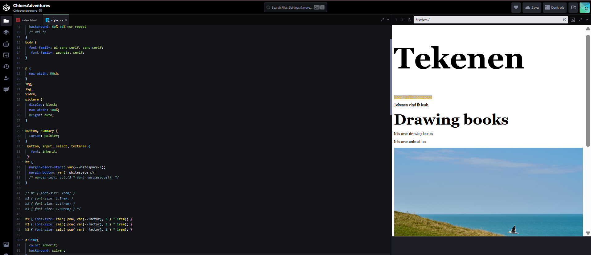
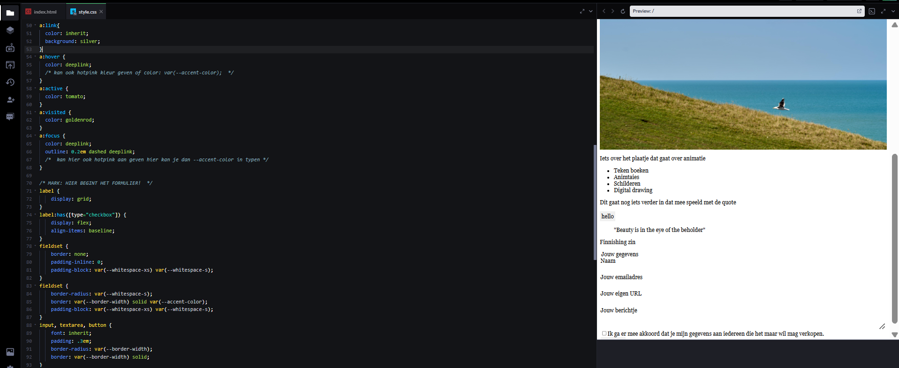
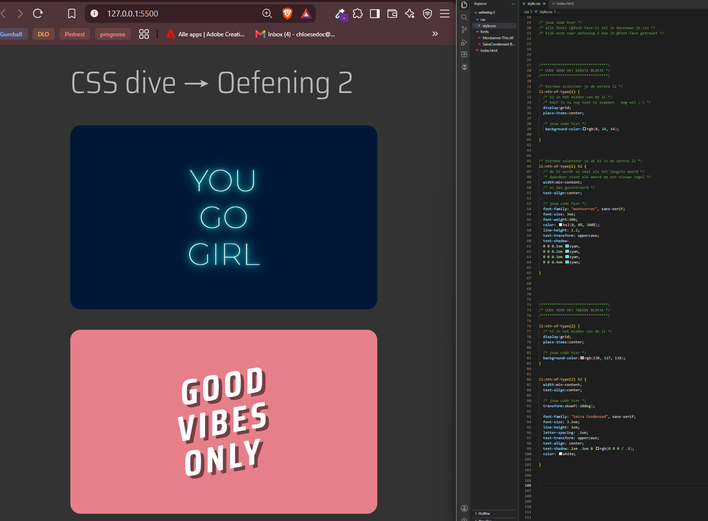

# Learning log

## Wo-11-11-2026

### Praktische CSS les1

### Fonts en lettertype Les1

Ik heb voor de eerste les van fonts en lettertype 2 oefeningen gedaan.
Deze oefeningen waren fijn om te doen, omdat ik wat nieuws heb geleerd, en ik snap nu beter wat ik aan het doen ben.

#### Oefening 1

Hier zijn we verder gaan werken aan de begin pagina.
We hebben hiervoor ook uitleg gekregen over de code. Ik vond dat wel fijn, omdat veel was weg gevallen. Ik weet nu ook beter waarvoor sommige dingen zijn, zoals de
(button, summary cursor: pointer)
Ik wil hier graag nieuwe code kunnen leren, zodat ik mijn uiteindelijke digital garden kan verbeteren ten opzichten van mijn vorige projecten. Na de les had ik ook al veel meer kennis dan daarvoor.

 

#### Oefening 2

Voor deze oefening moest ik code na maken. Ik vond dit wel een fijne oefening, want ik kon kijken naar wat ik al wel wist, en wat nog niet. Ik heb uiteindelijk wel gekeken bij het voorbeeld. Ik zag daardoor ook dat ik op de goede richting zat, maar net wat kleine dingetjes vergeten was.
Ik had het meest moeite met het juiste formaat vinden, (bijv: font-size: 3em) maar later ging dit wel beter.

#### Oefening 3

Voor deze oefening konden we zelf een font na maken. Ik vond de CMYK vond wel leuk.
Ik merkte dat ik er in het begin wel moeite mee had, omdat we steeds minder code als hulp middel kregen, en steeds meer zelf moesten doen. Ik heb ook gekeken naar mijn vorige code om te kijken of ik nog wat mis.

Het is uiteindelijk gelukt. Ik kwam er achter (door het op te zoeken) dat de 0.1em 0.1em 0.1em voor rechts, onder, en blur stond, en toen hoefde ik alleen nog de juiste groote, en de juiste volgorde toe te passen. Ik wilde echt proberen om dit zelf op te lossen, dus als ik iets ging opzoeken wilde ik ervoor zorgen dat ik niet gelijk het antwoord wist, of gewoon de code kon kopieëren, en plakken.

**before:**
_Dit was voordat ik realiseerde waar mijn fout zat. (te veel blur, verkeerde volgorde, en onjuiste posities)_

**After:**
_Dit is toen ik wist wat ik aan het doen was, en hoe ik mijn fout kon oplossen. Ik heb ook gelijk de zelfde achtergrond kleur gevonden._

Ik wilde ook nog de MYST font proberen, omdat ik dacht dat die wat makkelijker zou zijn.
Het is me tot nu toe niet helemaal gelukt, maar ik denk dat als ik verder blijf zoeken, ik er uiteindelijk wel uit kom.

**Het resultaat tot nu toe:**

Het lettertype komt nog niet helemaal overeen met de afbeelding die ik wil na maken\_

## Di-10-11-2026

### Voorbereiding Praktische CSS Les

Ik heb voor de volgende les al een basis gemaakt voor mijn digital garden.
Ik heb ervoor gekozen om het over tekenen te hebben, omdat dat mijn passie is, en als ik dit voor mijn portfolio wil gebruiken dan heb ik ook al gelijk resultaten die ik kan laten zien voor als ik iets met tekenen in het werk veld wil doen.

Ik moet alleen nog nadenken over de tekst, en wat ik precies wil vertellen, maar ik heb wel al een basis neergezet om het voor mezelf wat makkelijker te maken.

Ik heb ook nog oefeningen gedaan voordat ik begon met mijn digital garden.

#### Oefening 1 Font aanpassing

Ik had hier best wat moeite mee aangezien alles wat was weg gevallen. Ik heb het eerst zelf geprobeerd, en daarna ben ik gaan kijken hoe het wel moest. Ik heb hier wel van geleerd!

#### Oefening 2 Diner Game

Ik heb een dining game gespeeld om alvast wat code te oefenen.
In het begin merkte ik dat ik te moeilijk na dacht (ik was veel meer code aan het toevoegen dan nodig), uiteindelijk is het me gelukt, en ben ik tot lvl 17 gekomen.

 

## Ma-09-11-2026

### Leg uit wat een source hosting platform is en voor welke jij gekozen hebt.

Ik heb voor github gekozen, omdat ik daar eerder mee heb gewerkt, en omdat het gratis is. Op een hosting platform kan je, je website pupliceren.

### Vertel welke domeinnaam jij gekozen hebt en hoe je die hebt gekoppeld aan jouw pagina.

Ik heb voor mijn eigen naam gekozen om het simpel te houden, zodat ik het niet vergeet, of verkeerd spel. Ik heb dit gedaan door de dns te connecten met github via TransIP.

### Beschrijf hoe je aanpassingen aan jouw pagina kunt maken en hoe je er voor zorgt dat die op het web gepubliceerd worden.

Ik heb de titel aangepast. Ik heb dit gedaan door in de scource control aan te geven welke veranderingen ik heb gemaakt, en heb die toen ge commit. Daarna heb ik op Sync changes geklikt. Ik kan via mijn github bekijken of de veranderingen ook zijn toegepast.
