# Learning log

## do-26-11-2026'

### Tot nu toe

Ik ben verder gaan werken aan mijn digital garden. Ik heb de switch gemaakt voor dark en light mode met javascript. Ik heb deze website als voorbeeld gebruikt, maar ik wilde mijn eige plaatjes gebruiken, dus heb ik uiteindelijk hva ai chat gebruikt om me onderweg te helpen. Het is me uiteindelijk gelukt.

De orginele website waar ik het vandaan had: https://dev.to/dunia/implement-a-light-and-dark-mode-toggle-with-javascript-and-local-storage-19ce

[text](<fotos/Chat Export — Donkere en lichte modus toevoegen — 26-11-2026, 21_53_31.pdf>)

### Het probleem

- Had niet het juiste javascript mapje aangegeven. (waren 2 dezelfde met de zelfde naam, dus ik heb er 1 verandert, zodat het te vinden was).
- Licht modus was nog te zien op de dark mode als ik op een link klikte. (Ik zag dat ik html[data-theme= dark] bij 1 had, maar geen licht fucntie voor de ander. Dit heb ik toegevoegd, en toen werkte het wel).

### De toekomst

Ik ben van plan om alles mooi te maken door dingen toe te voegen.

- knoppen
- afbeeldingen
- kleur
- grootes
- plaatsing

Ik wil er iniedergeval voor zorgen dat de gallerij werkt, en ik wil toch mezelf uitdagen om de game te proberen te maken, omdat al mijn andere ideeën te moeilijk zijn (tot nu toe).

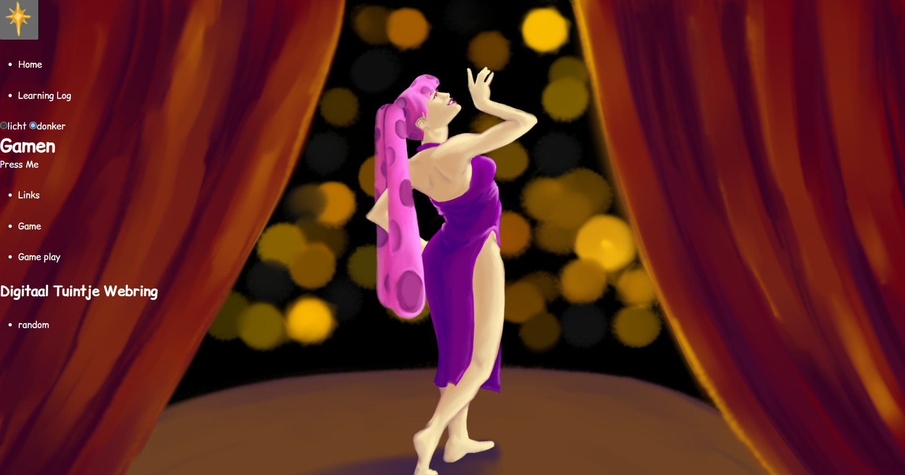

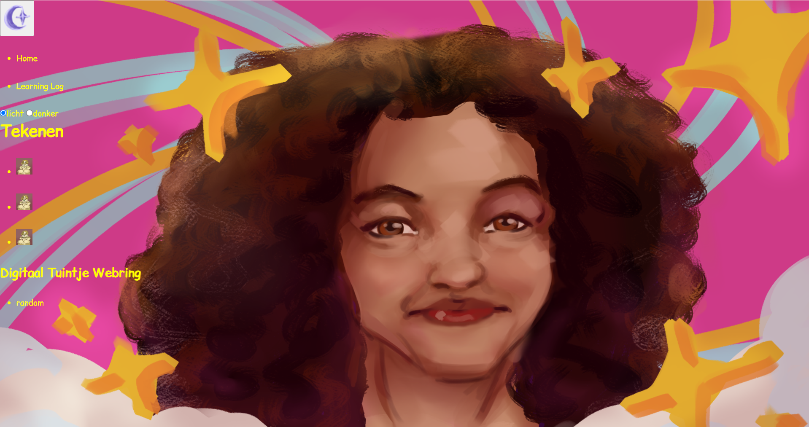

## Wo-25-11-2026

### Opdracht

We hebben in de les een opdracht gedaan waarbij we voor elkaar tekeningen hebben gemaakt om nog andere ideeën te krijgen.
Batuhan, en Luke hebben voor mij tekeningen gemaakt waardoor ik weer nieuwe inspiratie heb gekregen.

_Batuhan's tekening = een foto album idee voor mijn gallerij_

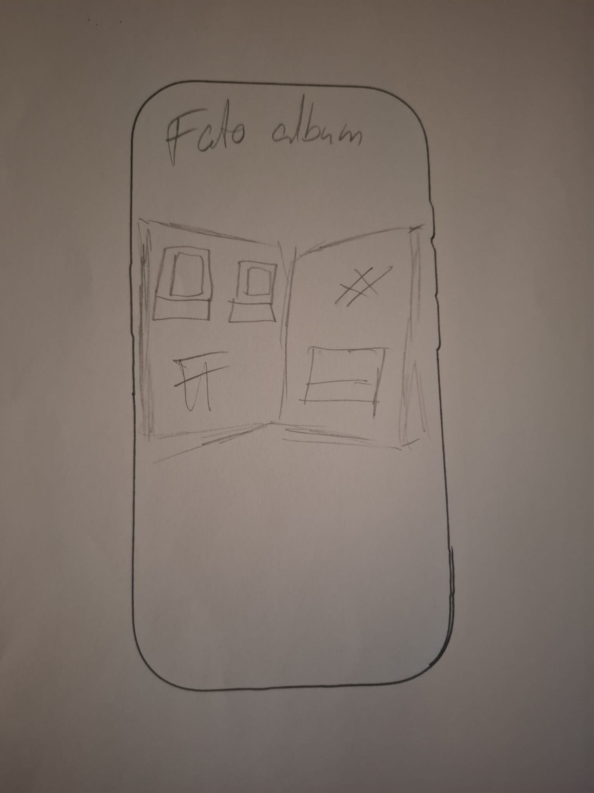

_Luke's tekening is een eventueele game, en een andere manier van een desktop in 3e persoons view_

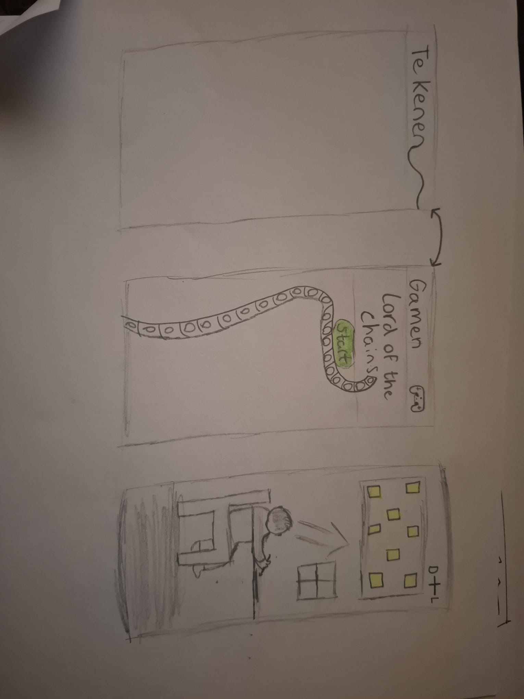

### CheckOut

Ik ben langzaam verder gaan werken aan mijn digital garden, maar ik kwam niet super ver, omdat ik me nog ziek voelden.
We hebben geleerd over gestald principes, zoals hierarchie, balans, en symetrie.
We hebben ook gezien hoe we grids goed kunnen gebruiken om structuur te bieden (fijne leesbaarheid), maar ook vrijheid (je kan bepalen wat mensen eerst en laatst zien).
Ik wil zelf ook gaan kijken of ik grids op zo een manier kan gebruiken. Ik wil ook kijken of ik mijn pagina goed kan structueren.

## Di-24-11-2026

### Grid

Ik heb een grid toegevoegd, zodat ik mijn tekeningen als gallerij kon laten zien. Dit is de website die ik daarvoor had gebruikt: https://www.freecodecamp.org/news/how-to-create-an-image-gallery-with-css-grid-e0f0fd666a5c/

Dit is hoe het er bij mij uitziet.
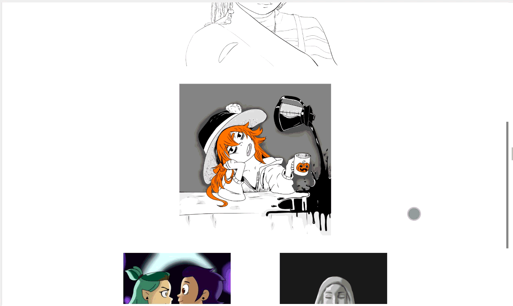

Ik heb aan de plaatjes gewerkt, en ik heb ze geprobeerd te animeren. De lange gaan van links naar rechts, en de kleinere gaan van onder naar boven. De grijse foto ben ik gaan hoveren met me muis, en die ging ook omhoog.

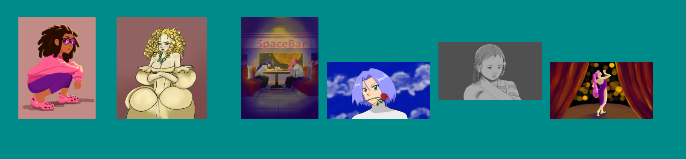

## ma-23-11-2026

### Bi-weekly Geek 1

We hebben in de les een opdracht gekregen waarbij we vragen over internet moesten beantwoorden, en onderzoek's vragen voor moesten bedenken.
Ik heb dit samen gedaan met Plamedie, en Pascha gedaan.

_Vragen_

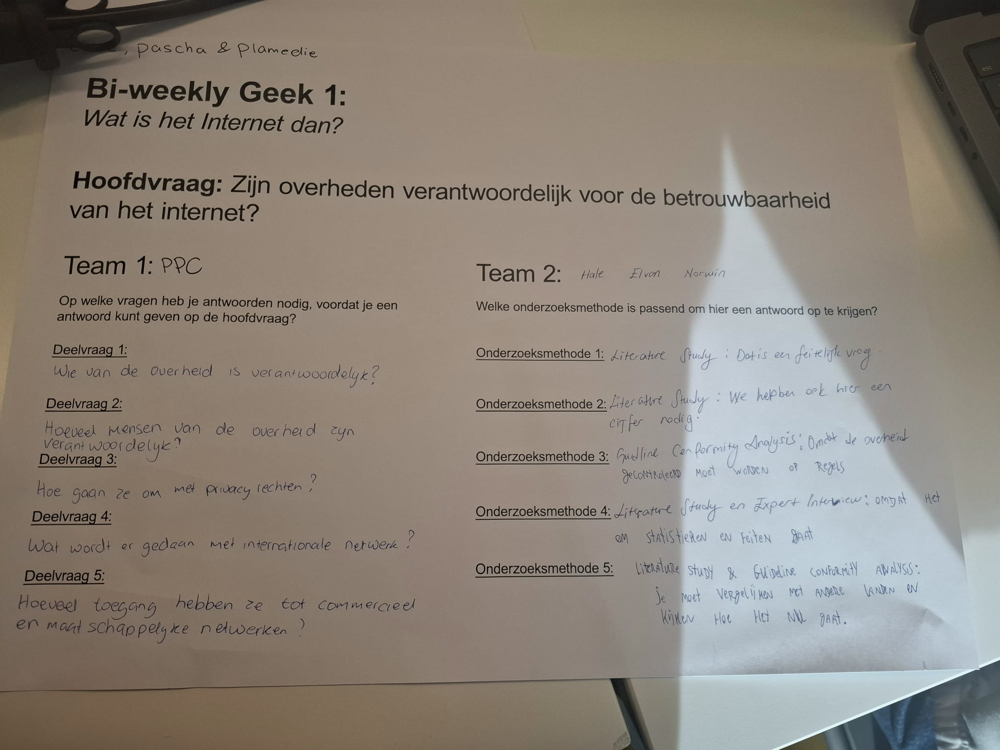

_Onderzoek_

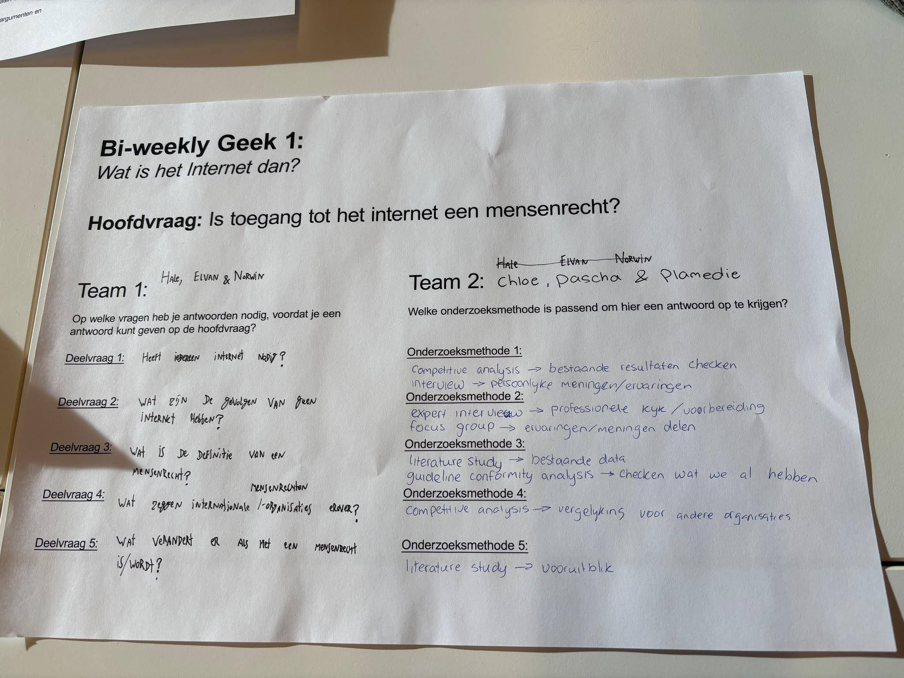

### Leg uit wanneer een website 'lelijk' wordt en geef voorbeelden wat je kan doen om deze 'lelijke' onderdelen te fixen?

Als je geen hierarchie toepast, of contrast.
Je kan duidelijk maken wat je wilt waar mensen eerst op focusen, en je kan ervoor zorgen dat het lees baar is. Dit kan je doen met groote, positie, en kleur.
Je kan ook nog witruimte laten, zodat je website niet te druk, of onoverzichtelijk word.

### Vertel welke volgende stap je neemt om je website responsive te maken.

Je kan @media gebruiken om (width) te bepalen. Hierdoor schaald je website mee als het beeld groter of kleiner word.
Je kan ook hover opties toevoegen, zodat de gebruiker feedback terug krijgt als ze op een knop klikken.

### Kun je het ontwerp en de bouw van je eigen Garden (zo uit je hoofd) onderbouwen in Webby vocabulair?

Ik wilde een desktop na creeëren, zodat je het gevoel heb dat je nog op je eige desktop zit. Ik wilde window popups creëren, maar dit bleek te lastig te zijn.
Wat ik wel kon doen is:
Dark en light modus toevoegen. Ik heb dit eerst gedaan door html:has([value="light"]:checked) toe te voegen en dan display: none; voor een specifieke id. Dit bleek maar tijdelijk te zijn, dus ga ik dit proberen met javascript.
Ik wil dat mensen mijn tekeningen kunnen bekijken via een soort gallery. Ik ben van plan om een grid hiervoor te gebruiken, zodat ze de plaatjes kunnen bekijken.
Ik wil ook kijken of ik een mini-game kan maken in darkmode, maar hiervoor heb ik ook javascript nodig, dus ik ga kijken of dit me gaat lukken.

## Za/zo-21/22-11-2026

Artikelen gelezen, en video's bekeken.

## Vr-20-11-2026

### Feedback

Ik heb feedback gekregen van mijn werk dat ik tot nu toe heb gedaan.
Ze raden aan om eerst te beginnen met de basis van html, en gewoon te beginnen met iconen.
Ik kreeg ook als feedback dat het maken van een game misschien niet gaat lukken.
Ik kan me het best focussen op de basis, en ik kan ook alvast wat tekeningen gaan maken voor de website.

## Wo-18-11-2026

### Leg uit waar het Visual Research in 3 stappen naartoe werkt

Het helpt je een idee te bedenken d.m.v visualisatie, en dat in 3 stappen proberen uit te werken.

### Vertel in 2 zinnen waar jouw Garden over gaat, en met welke content je dat gaat doen (beeld, tekst, sound, animatie enz).

Mijn garden gaat over tekenen, en gamen. Ik wil dit doen d.m.v beeld, tekst, en animatie.

### Vertel kort welk idee van de Crazy 8 je het liefst zou willen uitvoeren/ verder zou willen onderzoeken.

Ik wil kijken hoe ik een desktop kan maken met light en dark mode, en daarin dingen te verstoppen.
Ik wil ook proberen om een cusomized cursuor te maken.

### Gradients

Ik heb in de les geleerd over gradients, en snap nu beter welke code ik daarvoor moet gebruiken.
Ik wist al van custom properties, maar nu weet ik ook over verschillende variante (linear, radial, conic)

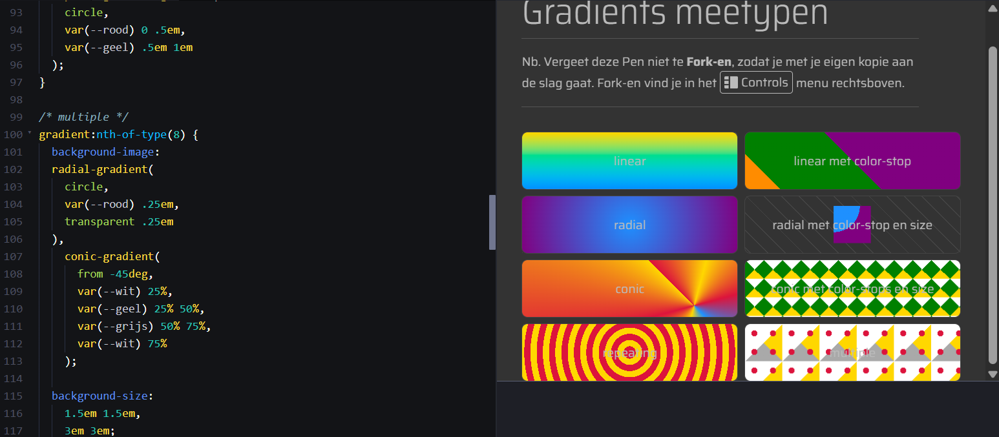

## Di-17-11-2026

Ik heb de oefening voor ligh_dark mode gedaan. (Ik was hiervoor aanwezig in de les om het te doen).
Ik heb vooral geleerd over custom properties, en has [value= ] :checked code.

_LightMode_
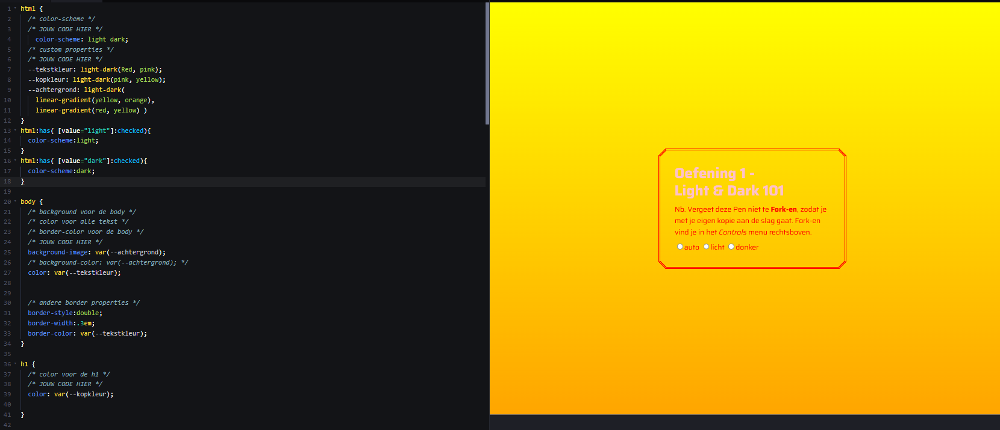

_DarkMode_
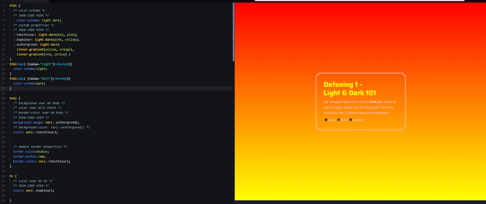

## Ma-16-11-2026

### Leg uit wat een digital garden is en waarom dat anders is dan een reguliere website.

Een digital garden is het tegen overgestelde van een web blog. Een digital garden heeft geen duidelijk begin, of eind. Je kan overal naar toe, en overal beginnen, of eindigen. Je bent nog aan het leren, en groeit met de ervaring die je ook laat zien (net zoals een bloem).

### Leg uit wat een website 'webby' maakt en welke websites jou het meeste inspireren.

Het moet bepaalde functies hebben (hover, screen size adjust, eventueel light, en dark modus)
Het moet toegankelijk zijn (hierarchie, contrast TAB functie).
Ik vond https://tamanotchi.world/ het meest inspirerend. Het had een leuke, en persoonlijke stijl.

### Vertel waar jij mee aan de slag wilt gaan bij het maken van jouw eigen digital garden (let op: dit zijn jouw eerste ideeën, dit kan en mag veranderen in de loop van het programma.)

Ik wil graag iets doen met tekenen, omdat ik dat zelf leuk vind. Ik denk dat het ook leuk is als ik een persoonlijke webpagina ook echt persoonlijk maak. Dit is ook iets dat ik uit mezelf zou doen, en niet omdat het moet voor een opdracht.

## Za-14-11-2026

Ik ben verder gaan werken aan de pagina in codepen.

### Transitie lettertype

In de vorige les kregen we als uitdaging om een transitie toe te voegen. Ik heb verschillende transities gemaakt om mezelf uit te dagen. Ik wilde kijken hoeveel ik zelf kon doen, en hoeveel ik nog wist, zodat ik later de moeilijkheidsgraad omhoog kan zetten, en mezelf nog meer kan uitdagen.

**GIF**

_Dit is het resultaat van de transitie. De video is een beetje choppy vergeleken met het live beeld, maar het idee is er. transitie's die ik gedaan heb (rotation, letter spacing, en scale)_

## Vr-13-11-2026

#### Beoordeling/Feedback

Hier gingen we elkaars werk beoordelen. We keken naar welke we het best, middelmatig, en minst goed vonden.
Ze hadden verschillende meningen over welke het best, en minst was, maar ik vond de feedback als nog fijn. Ik weet nu beter wat ik kan toepassen voor Lo,Mi,Hi-Fi schetsen, en waar ik rekening mee moet houden als ik een verhaal/schets duidelijk wil overbrengen.

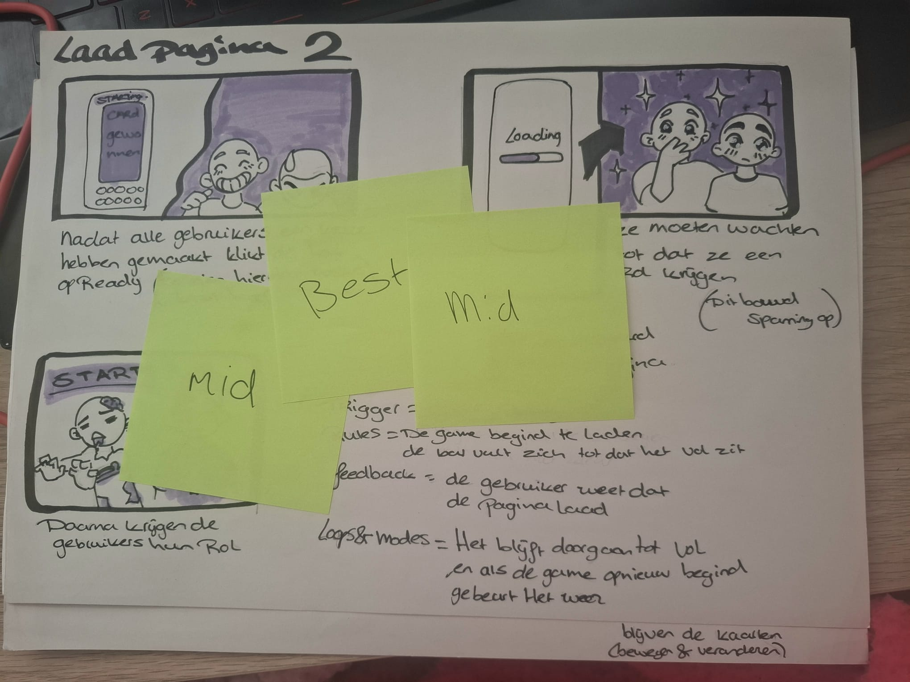

### Oefening opdrachten

We hebben schets lessen gekregen, en uiteindelijk moesten we daar een mi-fi schets uit maken, en een animatie schets proberen te maken.

_Ik had hier een Mi-Fi schets gemaakt, van youtube. Ik maakte per ongeluk een fout, en heb toen met een groene post it me fout weg gehaald. Ik merk hieraan dat ik al wat creatiever word in oplossingen vinden._

_Ik had gekozen om een popup na te schetsen, maar ik vond het toch nog wel lastig om visueel uit te tekenen_

### Css fonts en lettertype

Ik was gaan werken aan de vorige opdracht om het lettertype kloppend te maken (hier had ik moeite mee). Ik heb het uiteindelijk gevraagd aan copilot, en toen kwam ik erachter dat ik regular had toegevoegd, terwijl dat niet nodig was. Voor de rest lukte de opdracht me best goed, en daar ben ik wel blij mee.

_copilot gevraagd_

_Uiteindelijk resultaat_

## Do-12-11-2026

### Wok to walk

Ik heb als voorbereiding voor de volgende les alvast wat schetsen gemaakt voor wok to walk. Ik heb geprobeerd het zo kort mogelijk te houden, zodat mensen niet te veel hoeven te scrollen, en het menu gewoon kunnen scannen.

## Wo-11-11-2026

### Praktische CSS les1

In de les zijn we verder gaan werken aan de begin pagina.
We hebben hiervoor ook uitleg gekregen over de code. Ik vond dat wel fijn, omdat veel was weg gevallen. Ik weet nu ook beter waarvoor sommige dingen zijn, zoals de
(button, summary cursor: pointer)
Ik wil hier graag nieuwe code kunnen leren, zodat ik mijn uiteindelijke digital garden kan verbeteren ten opzichten van mijn vorige projecten. Na de les had ik ook al veel meer kennis dan daarvoor.

#### Fonts en lettertype

In de les moesten we fonts na maken. De eerste oefeningen hadden we voorbeeld code van, en de laatste oefening moesten we zelf de code ervoor schrijven.
Ik merkte dat ik er in het begin wel moeite mee had, omdat we steeds minder code als hulp middel kregen, en steeds meer zelf moesten doen. Ik heb ook gekeken naar mijn vorige code om te kijken of ik nog wat mis.

Het is uiteindelijk gelukt. Ik kwam er achter (door het op te zoeken) dat de 0.1em 0.1em 0.1em voor rechts, onder, en blur stond, en toen hoefde ik alleen nog de juiste groote, en de juiste volgorde toe te passen. Ik wilde echt proberen om dit zelf op te lossen, dus als ik iets ging opzoeken wilde ik ervoor zorgen dat ik niet gelijk het antwoord wist, of gewoon de code kon kopieëren, en plakken.

**before:**

_Dit was voordat ik realiseerde waar mijn fout zat. (te veel blur, verkeerde volgorde, en onjuiste posities)_

**After:**

_Dit is toen ik wist wat ik aan het doen was, en hoe ik mijn fout kon oplossen. Ik heb ook gelijk de zelfde achtergrond kleur gevonden._

## Di-10-11-2026

### Voorbereiding Praktische CSS Les

We hebben in de les basis oefeningen gedaan. Ik weet hierdoor al een beetje hoe ik fonts kan aanpassen, en hoe ik een basis html pagina kan maken. Dit was wel fijn, omdat ik weer even kon oefenen wat ik in het eerste jaar heb geleerd, maar dat even was weg gevallen.

## Ma-09-11-2026

### Leg uit wat een source hosting platform is en voor welke jij gekozen hebt.

Ik heb voor github gekozen, omdat ik daar eerder mee heb gewerkt, en omdat het gratis is. Op een hosting platform kan je, je website pupliceren.

### Vertel welke domeinnaam jij gekozen hebt en hoe je die hebt gekoppeld aan jouw pagina.

Ik heb voor mijn eigen naam gekozen om het simpel te houden, zodat ik het niet vergeet, of verkeerd spel. Ik heb dit gedaan door de dns te connecten met github via TransIP.

### Beschrijf hoe je aanpassingen aan jouw pagina kunt maken en hoe je er voor zorgt dat die op het web gepubliceerd worden.

Ik heb de titel aangepast. Ik heb dit gedaan door in de scource control aan te geven welke veranderingen ik heb gemaakt, en heb die toen ge commit. Daarna heb ik op Sync changes geklikt. Ik kan via mijn github bekijken of de veranderingen ook zijn toegepast.
