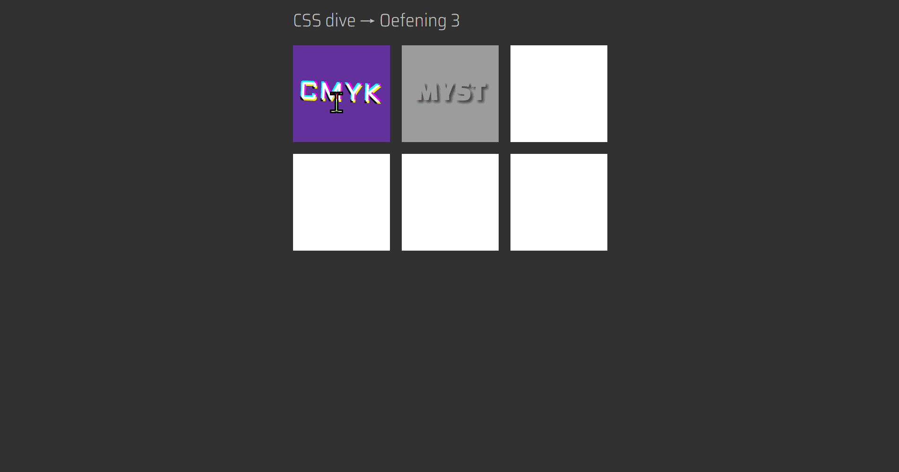
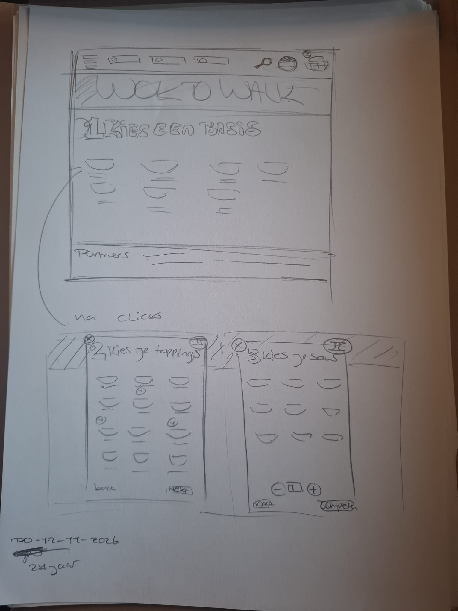
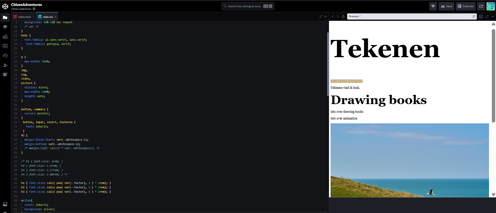

# Learning log

## Wo-18-11-2026

## Di-17-11-2026

## Ma-16-11-2026

## Za-14-11-2026

### Transitie lettertype

In de vorige les kregen we als uitdaging om een transitie toe te voegen. Ik heb verschillende transities gemaakt om mezelf uit te dagen. Ik wilde kijken hoeveel ik zelf kon doen, en hoeveel ik nog wist, zodat ik later de moeilijkheidsgraad omhoog kan zetten, en mezelf nog meer kan uitdagen.

**GIF**

_Dit is het resultaat van de transitie. De video is een beetje choppy vergeleken met het live beeld, maar het idee is er. transitie's die ik gedaan heb (rotation, letter spacing, en scale)_

## Vr-13-11-2026

#### Beoordeling/Feedback

Hier gingen we elkaars werk beoordelen. We keken naar welke we het best, middelmatig, en minst goed vonden.
Ze hadden verschillende meningen over welke het best, en minst was, maar ik vond de feedback als nog fijn. Ik weet nu beter wat ik kan toepassen voor Lo,Mi,Hi-Fi schetsen, en waar ik rekening mee moet houden als ik een verhaal/schets duidelijk wil overbrengen.

### Oefening opdrachten

We hebben schets lessen gekregen, en uiteindelijk moesten we daar een mi-fi schets uit maken, en een animatie schets proberen te maken.

_Ik had hier een Mi-Fi schets gemaakt, van youtube. Ik maakte per ongeluk een fout, en heb toen met een groene post it me fout weg gehaald. Ik merk hieraan dat ik al wat creatiever word in oplossingen vinden._

_Ik had gekozen om een popup na te schetsen, maar ik vond het toch nog wel lastig om visueel uit te tekenen_

### Css fonts en lettertype

Ik was gaan werken aan de vorige opdracht om het lettertype kloppend te maken (hier had ik moeite mee). Ik heb het uiteindelijk gevraagd aan copilot, en toen kwam ik erachter dat ik regular had toegevoegd, terwijl dat niet nodig was. Voor de rest lukte de opdracht me best goed, en daar ben ik wel blij mee.

_copilot gevraagd_

_Uiteindelijk resultaat_

## Do-12-11-2026

### Wok to walk

Ik heb als voorbereiding voor de volgende les alvast wat schetsen gemaakt voor wok to walk. Ik heb geprobeerd het zo kort mogelijk te houden, zodat mensen niet te veel hoeven te scrollen, en het menu gewoon kunnen scannen.

## Wo-11-11-2026

### Praktische CSS les1

In de les zijn we verder gaan werken aan de begin pagina.
We hebben hiervoor ook uitleg gekregen over de code. Ik vond dat wel fijn, omdat veel was weg gevallen. Ik weet nu ook beter waarvoor sommige dingen zijn, zoals de
(button, summary cursor: pointer)
Ik wil hier graag nieuwe code kunnen leren, zodat ik mijn uiteindelijke digital garden kan verbeteren ten opzichten van mijn vorige projecten. Na de les had ik ook al veel meer kennis dan daarvoor.

#### Fonts en lettertype

In de les moesten we fonts na maken. De eerste oefeningen hadden we voorbeeld code van, en de laatste oefening moesten we zelf de code ervoor schrijven.
Ik merkte dat ik er in het begin wel moeite mee had, omdat we steeds minder code als hulp middel kregen, en steeds meer zelf moesten doen. Ik heb ook gekeken naar mijn vorige code om te kijken of ik nog wat mis.

Het is uiteindelijk gelukt. Ik kwam er achter (door het op te zoeken) dat de 0.1em 0.1em 0.1em voor rechts, onder, en blur stond, en toen hoefde ik alleen nog de juiste groote, en de juiste volgorde toe te passen. Ik wilde echt proberen om dit zelf op te lossen, dus als ik iets ging opzoeken wilde ik ervoor zorgen dat ik niet gelijk het antwoord wist, of gewoon de code kon kopieëren, en plakken.

**before:**

_Dit was voordat ik realiseerde waar mijn fout zat. (te veel blur, verkeerde volgorde, en onjuiste posities)_

**After:**

_Dit is toen ik wist wat ik aan het doen was, en hoe ik mijn fout kon oplossen. Ik heb ook gelijk de zelfde achtergrond kleur gevonden._

## Di-10-11-2026

### Voorbereiding Praktische CSS Les

We hebben in de les basis oefeningen gedaan. Ik weet hierdoor al een beetje hoe ik fonts kan aanpassen, en hoe ik een basis html pagina kan maken. Dit was wel fijn, omdat ik weer even kon oefenen wat ik in het eerste jaar heb geleerd, maar dat even was weg gevallen.

## Ma-09-11-2026

### Leg uit wat een source hosting platform is en voor welke jij gekozen hebt.

Ik heb voor github gekozen, omdat ik daar eerder mee heb gewerkt, en omdat het gratis is. Op een hosting platform kan je, je website pupliceren.

### Vertel welke domeinnaam jij gekozen hebt en hoe je die hebt gekoppeld aan jouw pagina.

Ik heb voor mijn eigen naam gekozen om het simpel te houden, zodat ik het niet vergeet, of verkeerd spel. Ik heb dit gedaan door de dns te connecten met github via TransIP.

### Beschrijf hoe je aanpassingen aan jouw pagina kunt maken en hoe je er voor zorgt dat die op het web gepubliceerd worden.

Ik heb de titel aangepast. Ik heb dit gedaan door in de scource control aan te geven welke veranderingen ik heb gemaakt, en heb die toen ge commit. Daarna heb ik op Sync changes geklikt. Ik kan via mijn github bekijken of de veranderingen ook zijn toegepast.
