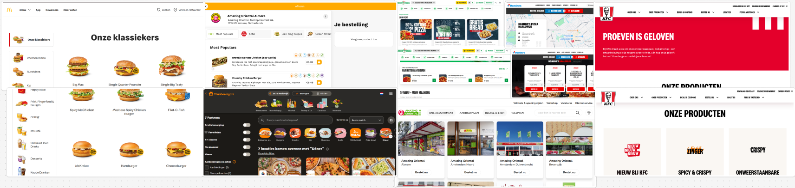
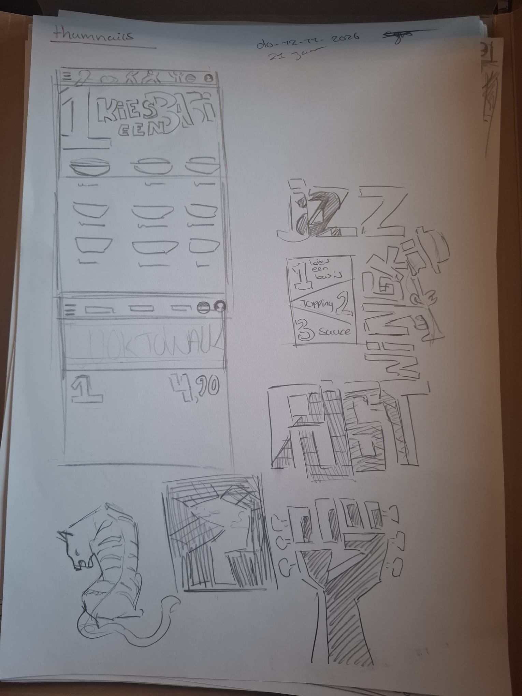
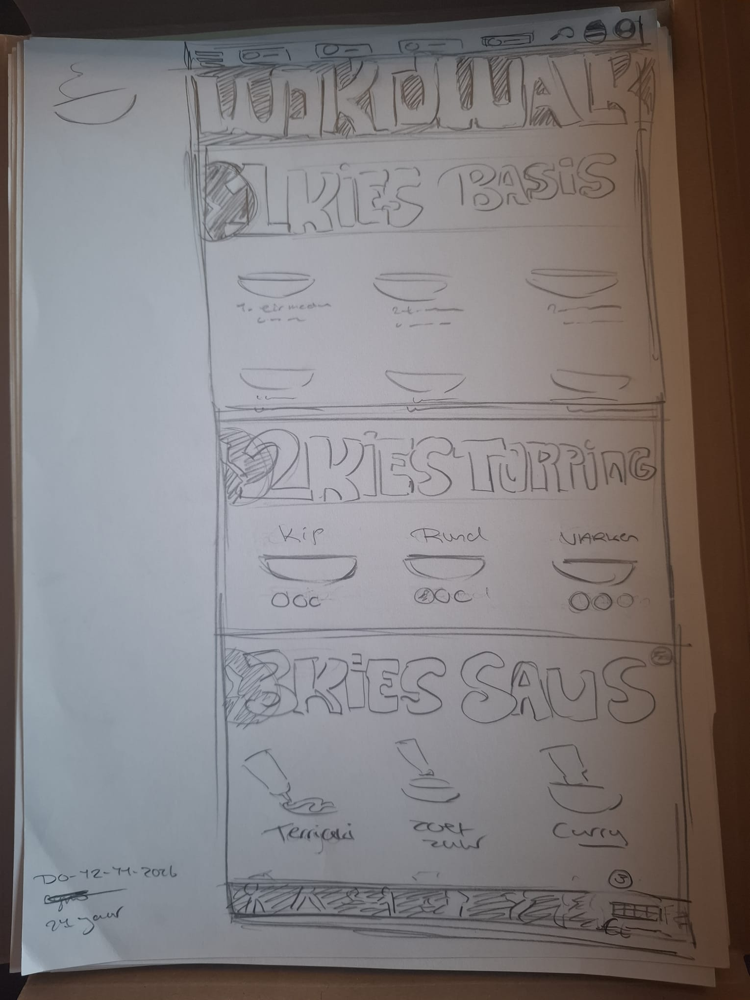
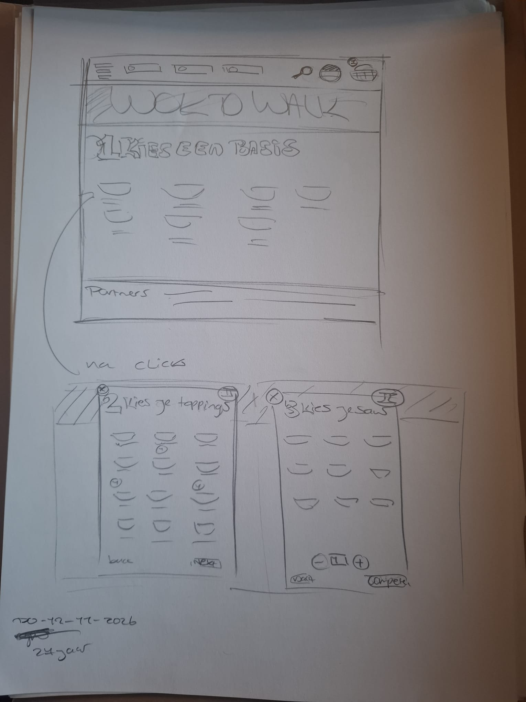

# Learning log

## Vr-13-11-2026

### Schets les

Ik heb in de les oefeningen gekregen over hoe we konden schetsen, en hoe we een Lo-fi Mi-fi, en Hi-Fi kunnen schetsen.
Ik hou zelf ook al van tekenen, dus ik vond dit wel een leuke opdracht. Ondanks dat ik al wat kennis heb van tekenen heb ik wel het gevoel dat ik wat nieuws heb geleerd, dat me toch kan helpen om een betere visalusatie over te brengen naar andere.

**Beoordeling/Feedback**
Hier gingen we elkaars werk beoordelen. We keken naar welke we het best, middelmatig, en minst goed vonden.
Mijn feedback die ik heb gekregen van Pasha, Palmedie, en Medea:
De schetsen zien er goed uit, maar de schets van de bal is het meest duidelijk, omdat je niet hoeft te lezen. De andere is te veel tekst. De accent kleur is leuk, en het voelt finnished. De schets met potlood voelt ook echt als een schets.
Ze hadden verschillende meningen over welke het best, en minst was, maar ik vond de feedback als nog fijn. Ik weet nu beter wat ik kan toepassen voor Lo,Mi,Hi-Fi schetsen.

[Foto's toevoegen]

**1ste oefening**
We begonnen met lijnen tekenen over een A3 het doel was om zo recht mogelijk, en gelijk van elkaar af te tekenen. Ik heb dit ooit al eerder gedaan voor mezelf, maar niet op een A3. Ik vond dit wel handig om weer te doen, omdat het me toch uitdaagde om recht en netjes te tekenen. Ik focusde meer op de oefening, en niet zo zeer op perfectie, omdat de kans dat ik dan schuin teken veel groter is.

**2e oefening**
Hier moesten we vierkanten tekenen op een A3. Ik vond dit ook wel leuk, omdat ik het gevoel had dat het een extentie is van de lijnen tekenen. Ik heb het gevoel dat ik opnieuw weer kon beginnen met teken oefeningen, en gelijk ook kon zien of ik ben verbeterd.

**3e oefening**
Nu moesten we proberen om een telefoon zo goed mogelijk na te maken. Dit leek makkelijk, maar inschatten is ook een vermogen die ik tot nu toe niet echt bezit. Mijn telefoon schetsen waren of te klein, breed, of te lang. Het gaat gelukkig om het ongeveer, en ik

**4e oefening**
We mochten een app kiezen die we zelf vaak gebruiken, en daar een Mi-Fi schets van maken, met alle kennis die we hebben gekregen van de vorige oefeningen.

**5e oefening**
We hebben als laatst een animatie schets gemaakt.
We zijn gaan kijken naar de schetsen die we hadden gemaakt voor Wok to Walk, en zijn gaan kijken naar wat voor animaties we konden toevoegen.

Ik heb voor een popup animatie gekozen.
Als je een basis kiest (inplaats van helemaal door te moeten scrollen) krijg je een popup te zien, met de volgende keuze (toppings). Ik heb geprobeerd dit op papier te laten zien.
Het bedenken, en de actie in me hoofd zien ging wel, maar het op papier vertalen vond ik wel een stuk lastiger, daarom denk ik ook dat de schets wat beter kon.

### Css fonts en lettertype

Ik ben verder gaan werken aan de vorige opdracht (lettertype fonts)
Ik heb toen de 2e lettertype MYST geprobeerd na te maken.
Het was me gelukt om de schaduw na te maken, maar ik bleef vast lopen bij het lettertype.
Ik kreeg niet het juiste lettertype te zien, als op het voorbeeld. Ik heb eerst geprobeerd dit zelf te fixen, maar uiteindelijk heb ik copilot gevraagd wat er precies niet klopte, en waarom ik mijn font niet kon zien.

**Before**

Hier had ik moeite met het vinden van de fout in mijn code. Ik heb meerdere aanpassingen gedaan. met haakjes toe te voegen, lettertype groote, groter maken, stijl aanpassen naar oblique, en Uppercase veranderen naar capitalize. Dit werkte allemaal niet.

**After**

Hier heb ik aan copilot gevraagd waarom het lettertype niet werkte.
Hij zei dat het kwam, omdat ik vroeg om blackHanSans.Regulat.tt, maar ik had alleen BlackHan nodig.
Dit heb ik aangepast, en toen werkte het inderdaad wel.

**Eind resultaat**
Ik heb als laatst de groote van beide lettertype vergroot naar 4rem om ze nog beter zichtbaar te maken. Dit is het uiteindelijke resultaat.

## Do-12-11-2026

### Wok to walk

Ik heb als voorbereiding voor de volgende les alvast wat schetsen gemaakt voor wok to walk.
Ik ben eerst een kleine moodboard gaan maken om inspiratie te krijgen voor de website.
Ik heb 3 schetsen op papier gemaakt.

**Moodboard**

Ik ben voor de moodboard gaan kijken naar andere bestellings website's om te kijken hoe hun, hun website hebben vorm gegeven.

**Schets1**

Voor schets 1 ben ik vooral gaan nadenken over wat voor elementen ik wilde verwerken.

**Schets2**

Voor de 2e schets ben ik gaan experimenteren met een layout begin.

**Schets3**

Voor de 3e schets heb ik nog een alternatief bedacht van hoe ik de website zo kort mogelijk kon houden, zodat mensen niet te ver hoeven te scrollen.

## Wo-11-11-2026

### Praktische CSS les1

Hier zijn we verder gaan werken aan de begin pagina.
We hebben hiervoor ook uitleg gekregen over de code. Ik vond dat wel fijn, omdat veel was weg gevallen. Ik weet nu ook beter waarvoor sommige dingen zijn, zoals de
(button, summary cursor: pointer)
Ik wil hier graag nieuwe code kunnen leren, zodat ik mijn uiteindelijke digital garden kan verbeteren ten opzichten van mijn vorige projecten. Na de les had ik ook al veel meer kennis dan daarvoor.

 

### Fonts en lettertype Les1

Ik heb voor de eerste les van fonts en lettertype 2 oefeningen gedaan.
Deze oefeningen waren fijn om te doen, omdat ik wat nieuws heb geleerd, en ik snap nu beter wat ik aan het doen ben.

#### Oefening 2

Voor deze oefening moest ik code na maken. Ik vond dit wel een fijne oefening, want ik kon kijken naar wat ik al wel wist, en wat nog niet. Ik heb uiteindelijk wel gekeken bij het voorbeeld. Ik zag daardoor ook dat ik op de goede richting zat, maar net wat kleine dingetjes vergeten was.
Ik had het meest moeite met het juiste formaat vinden, (bijv: font-size: 3em) maar later ging dit wel beter.

#### Oefening 3

Voor deze oefening konden we zelf een font na maken. Ik vond de CMYK vond wel leuk.
Ik merkte dat ik er in het begin wel moeite mee had, omdat we steeds minder code als hulp middel kregen, en steeds meer zelf moesten doen. Ik heb ook gekeken naar mijn vorige code om te kijken of ik nog wat mis.

Het is uiteindelijk gelukt. Ik kwam er achter (door het op te zoeken) dat de 0.1em 0.1em 0.1em voor rechts, onder, en blur stond, en toen hoefde ik alleen nog de juiste groote, en de juiste volgorde toe te passen. Ik wilde echt proberen om dit zelf op te lossen, dus als ik iets ging opzoeken wilde ik ervoor zorgen dat ik niet gelijk het antwoord wist, of gewoon de code kon kopieëren, en plakken.

**before:**

_Dit was voordat ik realiseerde waar mijn fout zat. (te veel blur, verkeerde volgorde, en onjuiste posities)_

**After:**

_Dit is toen ik wist wat ik aan het doen was, en hoe ik mijn fout kon oplossen. Ik heb ook gelijk de zelfde achtergrond kleur gevonden._

Ik wilde ook nog de MYST font proberen, omdat ik dacht dat die wat makkelijker zou zijn.
Het is me tot nu toe niet helemaal gelukt, maar ik denk dat als ik verder blijf zoeken, ik er uiteindelijk wel uit kom.

**Het resultaat tot nu toe:**

_Het lettertype komt nog niet helemaal overeen met de afbeelding die ik wil na maken_

## Di-10-11-2026

### Voorbereiding Praktische CSS Les

Ik heb voor de volgende les al een basis gemaakt voor mijn digital garden.
Ik heb ervoor gekozen om het over tekenen te hebben, omdat dat mijn passie is, en als ik dit voor mijn portfolio wil gebruiken dan heb ik ook al gelijk resultaten die ik kan laten zien voor als ik iets met tekenen in het werk veld wil doen.

Ik moet alleen nog nadenken over de tekst, en wat ik precies wil vertellen, maar ik heb wel al een basis neergezet om het voor mezelf wat makkelijker te maken.

Ik heb ook nog oefeningen gedaan voordat ik begon met mijn digital garden.

#### Oefening 1 Font aanpassing

Ik had hier best wat moeite mee aangezien alles wat was weg gevallen. Ik heb het eerst zelf geprobeerd, en daarna ben ik gaan kijken hoe het wel moest. Ik heb hier wel van geleerd!

#### Oefening 2 Diner Game

Ik heb een dining game gespeeld om alvast wat code te oefenen.
In het begin merkte ik dat ik te moeilijk na dacht (ik was veel meer code aan het toevoegen dan nodig), uiteindelijk is het me gelukt, en ben ik tot lvl 17 gekomen.

 

## Ma-09-11-2026

### Leg uit wat een source hosting platform is en voor welke jij gekozen hebt.

Ik heb voor github gekozen, omdat ik daar eerder mee heb gewerkt, en omdat het gratis is. Op een hosting platform kan je, je website pupliceren.

### Vertel welke domeinnaam jij gekozen hebt en hoe je die hebt gekoppeld aan jouw pagina.

Ik heb voor mijn eigen naam gekozen om het simpel te houden, zodat ik het niet vergeet, of verkeerd spel. Ik heb dit gedaan door de dns te connecten met github via TransIP.

### Beschrijf hoe je aanpassingen aan jouw pagina kunt maken en hoe je er voor zorgt dat die op het web gepubliceerd worden.

Ik heb de titel aangepast. Ik heb dit gedaan door in de scource control aan te geven welke veranderingen ik heb gemaakt, en heb die toen ge commit. Daarna heb ik op Sync changes geklikt. Ik kan via mijn github bekijken of de veranderingen ook zijn toegepast.
